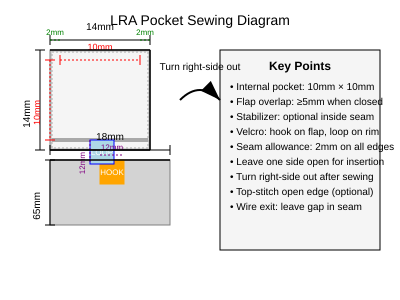
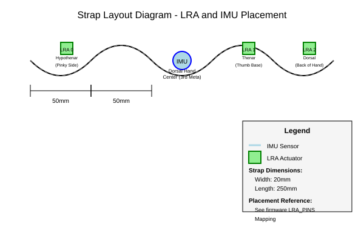
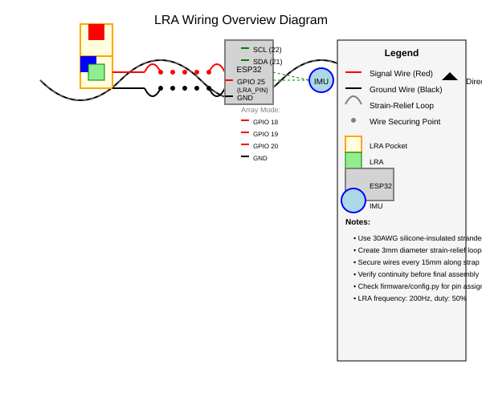

# LRA Integration Assembly Guide

This guide provides detailed, step-by-step instructions for integrating Linear Resonant Actuators (LRAs) into the wearable IMU tremor monitoring system. It includes mounting, wiring, firmware configuration, and validation procedures.

## Table of Contents
1. [Introduction](#introduction)
2. [Parts and Tools Required](#parts-and-tools-required)
3. [Firmware Preparation](#firmware-preparation)
4. [Mounting Procedure](#mounting-procedure)
5. [Wiring Procedure](#wiring-procedure)
6. [Assembly Integration](#assembly-integration)
7. [Flashing and Testing](#flashing-and-testing)
8. [Maintenance and Troubleshooting](#maintenance-and-troubleshooting)
9. [Reference Diagrams](#reference-diagrams)
10. [Bill of Materials](#bill-of-materials)

---

## Introduction
This guide covers the addition of haptic feedback via LRAs to an existing IMU-based tremor monitoring system. The system uses an ESP32 with hierarchical stage processing (HSP) firmware. LRAs provide vibratory feedback based on tremor classification labels (rest, postural, kinetic, grasp_guidance).

**Intended Audience**: Makers, researchers, or clinicians with basic soldering and sewing skills.
**Prerequisites**: 
- Firmware source (ForumProject/firmware) with config.py and haptic stage
- Basic understanding of MicroPython and ESP32
- Ability to sew and solder

---

## Parts and Tools Required

### Electronic Components
- ESP32 development board (e.g., ESP32-WROOM-32)
- IMU (MPU6050 or similar, already integrated)
- Linear Resonant Actuators (LRAs): 
  - Single LRA: ~10mm × 10mm × 3-4mm, resonant ~200Hz
  - LRA Array: 3x same LRAs for hypothenar, thenar, dorsal placement
- Wiring: 30AWG silicone-insulated stranded wire (2-core)
- Connectors (optional): micro-JST PH 2-pin for detachable wiring
- Heat-shrink tubing (various sizes: 1.5mm, 3mm, 6mm)

### Mounting Materials
- Elastic nylon/spandex strap (15-35mm wide, 4-way stretch)
- Breathable mesh fabric panels (optional for ventilation)
- Stabilizer strips (2-3mm cotton webbing or twill tape)
- Hook-and-loop tape (Velcro): sew-on type, 15-20mm width
- Fabric scissors, ruler, fabric chalk or washable marker
- Sewing pins or clips, fine needle
- Polyester/nylon upholstery thread (matches strap color)
- Optional: silicone grip dots, fabric adhesive

### Tools
- Soldering iron and solder (lead-free, rosin-core)
- Wire strippers/cutters
- Tweezers
- Heat gun or lighter
- Multimeter (for validation)
- Fabric glue or flexible epoxy (e.g., E6000, Sugru) for wire securing
- Scissors

---

## Firmware Preparation
Before assembling, verify firmware configuration matches your hardware.

### 1. Review Configuration
Check `firmware/common/config.py`:
```python
# Hardware pins
LED_PIN = 2
LRA_PIN = 25                     # Single LRA GPIO
LRA_FREQ = 200                   # PWM frequency (Hz)
LRA_PINS = [18, 19, 20]          # Array: [hypothenar, thenar, dorsal]
USE_LRA_ARRAY = False            # Set True for array mode
# LRA duty cycles
LRA_DUTY_ON = 512                # 50% duty cycle (of 1024)
LRA_DUTY_OFF = 0
```

### 2. Verify Haptic Stage
Review `firmware/stages/haptic.py`:
- Confirms `LRA_DUTY_ON = 512` and `LRA_DUTY_OFF = 0`
- Implements label-based control:
  - `rest`/`baseline`: LED off, LRA off (0% duty)
  - `postural`: LED blinks 1Hz, LRA off
  - `kinetic`: LED on, LRA pulses 2Hz square wave (50% duty)
  - `grasp_guidance`/other: LED on, LRA on steady (single mode) or spatial sequence (array)

> **Note**: No firmware changes needed for basic LRA integration. Ensure `USE_LRA_ARRAY` matches your wiring (single or array).

---

## Mounting Procedure
Follow these steps to create secure, removable pockets for LRAs on the elastic strap.

### Pocket Dimensions
For typical LRA (~10mm × 10mm × 3-4mm):
- **Shell pieces**: 14mm × 14mm cut (10mm internal + 2mm seam allowance)
- **Flap**: 18mm × 13mm cut
- **Velcro squares**: 12mm × 12mm (hook on flap underside, loop on pocket rim)

See detailed diagram: 

### Step-by-Step Construction

#### Step 1: Cut Fabric Pieces
1. Cut two shell pieces: 14mm × 14mm rectangles
2. Cut one flap piece: 18mm × 13mm rectangle
3. Cut two Velcro squares: 12mm × 12mm (one hook, one loop)
4. Optional: cut stabilizer strip (~2-3mm wide × 9mm long)

#### Step 2: Prepare Velcro
- Hook side (rough) attaches to flap underside
- Loop side (soft) attaches to inside rim of pocket opening

#### Step 3: Sew Pocket Shell
1. Place stabilizer strip (if using) inside one shell piece
2. Right sides together, sew three sides with 2mm seam (leave one side open)
3. Turn right-side out; press flat
4. Trim corners to reduce bulk

#### Step 4: Attach Velcro
1. Sew hook-side Velcro to underside center of flap
2. Sew loop-side Velcro to inside rim of pocket opening
3. Test alignment: flap should close securely with full Velcro contact

#### Step 5: Finish Edges (Optional)
Fold raw edges inward 2mm and top-stitch for clean finish (or leave if flap covers edge).

#### Step 6: Mount Pocket to Strap
1. Position pocket at desired location (see strap layout diagram)
2. Sew outer edges of pocket to elastic strap, avoiding flap opening
3. Use stitches that allow stretch (e.g., zigzag or loose running stitch)
4. Verify LRA slides in with light pressure; flap overlaps opening by ≥5mm

See strap layout: 

#### Step 7: Prepare for Wiring
Leave a small gap in the seam where wires will exit the pocket toward the ESP32.

> **Maintenance**: Hand wash with mild soap, air dry. Lint roll Velcro after washing. Inspect elastic monthly for loss of recovery.

---

## Wiring Procedure
Follow these steps to wire LRAs to the ESP32 with strain relief for durability.

### Wire Preparation
Use 30AWG silicone-insulated stranded wire for flexibility.

See wiring overview: 

### Step-by-Step Wiring

#### Step 1: Cut and Strip Wires
1. For each LRA, cut two wire lengths:
   - LRA to pocket exit: ~20mm
   - Pocket exit to ESP32: measure route + 20mm slack
2. Strip 3mm insulation from each end; twist strands to prevent fraying

#### Step 2: Tin Wire Ends
Apply solder to each stripped end to prevent oxidation.

#### Step 3: Solder to LRA Terminals
1. Identify LRA terminals (note polarity if polarized)
2. Secure LRA; solder each wire to a terminal
3. Inspect joints: should be smooth, concave fillets
4. Slide heat-shrink over joints; apply heat to insulate

#### Step 4: Add Strain Relief at LRA
1. Measure 5mm from solder joint; bend wire back to form 3mm diameter loop
2. Secure loop to pocket interior with stitches or flexible epoxy
3. Loop absorbs bending forces, protecting solder joint

#### Step 5: Route Wires Along Strap
1. Lay wires along inside of strap, following natural contours
2. Avoid sharp bends; use gradual curves
3. Secure wires every 15mm with:
   - Stitches: loose loop over wire (not through wire) stitched to strap
   - OR flexible epoxy dots (e.g., Sugru)
4. Keep wires flat and without twists

#### Step 6: Add Strain Relief at Strap Exit
1. Before reaching ESP32, create second 3mm diameter strain-relief loop
2. Secure loop to strap with stitches or epoxy

#### Step 7: Prepare ESP32 End
1. Strip 3mm insulation; tin ends
2. Optional: crimp micro-JST pins for detachable wiring
3. Alternative: solder directly to ESP32 GPIO pins

#### Step 8: Connect to ESP32
1. Identify GPIOs from `firmware/common/config.py`:
   - Single LRA: `LRA_PIN` (GPIO 25) and GND
   - LRA Array: `LRA_PINS[0]` (GPIO 18), [1] (GPIO 19), [2] (GPIO 20) and common GND
2. Solder wires:
   - One wire to GPIO pin (signal)
   - Other wire to GND
3. Insulate ESP32 joints with heat-shrink tubing

#### Step 9: Validate Wiring
1. **Continuity Check**: 
   - Between LRA wires: near 0Ω
   - Between each wire and its ESP32 connection: near 0Ω
   - Between signal and ground: open (no continuity)
   - Between adjacent signal wires (array): open
2. **Mechanical Test**: Flex strap; wires should move freely without pulling on joints

> **Notes**: 
> - Use consistent colors (e.g., red = signal, black = ground)
> - Verify no shorts before powering ESP32
> - LRA frequency must be 200Hz; duty cycle 50% (512/1024)

---

## Assembly Integration
Combine mounted LRAs and wired connections into the final system.

### Component Placement
Refer to firmware `LRA_PINS` for anatomical mapping:
- **LRA 0** (GPIO 18): hypothenar (pinky side of wrist)
- **LRA 1** (GPIO 19): thenar (thumb base)
- **LRA 2** (GPIO 20): dorsal (back of hand)
- **IMU**: dorsal hand center (3rd metacarpal) for minimal motion artifact

### Final Checks Before Use
1. LRA slides into pocket with light pressure (no force)
2. Flap overlaps opening by ≥5mm for secure closure
3. Full range of motion is not restricted
4. Wires lie flat; no pressure points or discomfort
5. Continuity from ESP32 GPIO to LRA terminals confirmed
6. No shorts between signal and ground

---

## Flashing and Testing
Flash firmware and validate LRA behavior.

### Flashing Order (per embed_readme.md)
1. `fft.py`
2. `feature_extract.py`
3. `logreg.py`
4. `scaler.py`
5. `model.py`
6. `embedded_main_hsp.py` (last)

### Functional Validation
Observe LED and LRA behavior per tremor label:

| Label          | LED Behavior       | LRA Behavior (Single Mode)        | LRA Behavior (Array Mode)       |
|----------------|--------------------|-----------------------------------|---------------------------------|
| rest/baseline  | Off                | Off (0% duty)                     | Off                             |
| postural       | Blinks 1Hz         | Off                               | Off                             |
| kinetic        | On                 | Pulses 2Hz (50% duty square wave) | All pulse 2Hz in unison         |
| grasp_guidance | On                 | On steady (50% duty)              | Spatial sequence (0→1→2→0... at ~3Hz) |

### Wear Test
1. Wear assembly for 10-15 minutes
2. Check for comfort, slippage, or skin irritation
3. Adjust pocket placement if LRA causes discomfort or poor coupling
4. Verify haptic feedback matches expected tremor states

---

## Maintenance and Troubleshooting

### Regular Care
- **Cleaning**: Hand wash with mild soap; air dry completely
- **Velcro**: Lint roll hook side after washing; replace if grip diminishes
- **Elastic**: Inspect monthly; replace when stretched out significantly
- **Seams**: Check for fraying; resew if needed
- **Wires**: Inspect for fatigue at bend points; check solder joints

### Common Issues and Solutions

| Issue                          | Likely Cause                          | Solution                                      |
|--------------------------------|---------------------------------------|-----------------------------------------------|
| No vibration                   | Wrong GPIO, broken wire, firmware issue | Check continuity, verify GPIO in config, reflash |
| Intermittent vibration         | Wire fatigue, loose joint             | Inspect strain relief, resolder joints        |
| Weak/sporadic vibration        | Incorrect PWM frequency/duty          | Verify `LRA_FREQ=200`, `LRA_DUTY_ON=512`     |
| Excessive heating              | Stuck at 100% duty, DC offset         | Check firmware logic, measure PWM             |
| Detachment during movement     | Insufficient flap overlap             | Remove and remake pocket with ≥5mm overlap    |
| Skin irritation from Velcro    | Velcro contacting skin                | Reposition pocket or add fabric barrier       |
| Pocket sags under LRA weight   | Missing stabilizer                    | Add stabilizer strip inside pocket seam       |

### Testing with Multimeter
- **Continuity**: Set to lowest Ω setting; expect <1Ω for good connections
- **Shorts**: Check between signal and ground; should be open (OL)
- **PWM Signal**: Use oscilloscope to verify 200Hz square wave on GPIO

---

## Reference Diagrams
The following diagrams illustrate key concepts:

### Strap Layout
Shows anatomical placement of IMU and LRAs on the strap.


### LRA Pocket Construction
Details pocket dimensions, seam allowance, and Velcro placement.


### Wiring Overview
Illustrates wire routing, strain relief loops, and ESP32 connections.


---

## Bill of Materials (BOM)
| Item                          | Specification                          | Quantity | Notes                                  |
|-------------------------------|----------------------------------------|----------|----------------------------------------|
| ESP32 Dev Board               | ESP32-WROOM-32 or similar              | 1        |                                        |
| IMU Sensor                    | MPU6050 or compatible                  | 1        | Already integrated                     |
| Linear Resonant Actuator (LRA)| ~10mm × 10mm × 3-4mm, 200Hz resonant   | 1 or 3   | Single or array                        |
| Wire                          | 30AWG silicone-insulated stranded      | ~1m      | 2-core recommended                     |
| Heat-shrink Tubing            | Assorted sizes (1.5mm, 3mm, 6mm)       | 1 pack   | For solder joints                      |
| Elastic Strap                 | Nylon/spandex, 15-35mm wide            | ~0.5m    | 4-way stretch                          |
| Velcro (Hook & Loop)          | Sew-on, 15-20mm width                  | ~0.2m each |                                        |
| Stabilizer Strip              | Cotton webbing or twill tape           | ~0.1m    | Optional, inside pocket seam           |
| Thread                        | Polyester/nylon upholstery             | 1 spool  | Match strap color                      |
| Solder                        | Lead-free, rosin-core                  | 1 spool  |                                        |
| Connectors (Optional)         | Micro-JST PH 2-pin                     | 1 set    | For detachable wiring                  |
| Adhesive (Optional)           | Flexible epoxy (Sugru, E6000)          | 1 tube   | For wire securing                      |

> **Estimated Cost**: $15-$30 depending on quantity and suppliers.

---

## Conclusion
This guide provides a complete workflow for integrating LRAs into the wearable IMU tremor monitoring system. By following these steps, you will create a durable, comfortable, and functional haptic feedback module that interfaces seamlessly with the existing firmware.

**Final Validation**: 
1. Flash firmware using the correct order
2. Observe LED/LRA patterns match expected labels
3. Wear assembly to confirm comfort and functionality
4. Perform regular maintenance to ensure longevity

For questions or issues, consult the firmware source (`firmware/common/config.py` and `firmware/stages/haptic.py`) and refer to the troubleshooting table above.